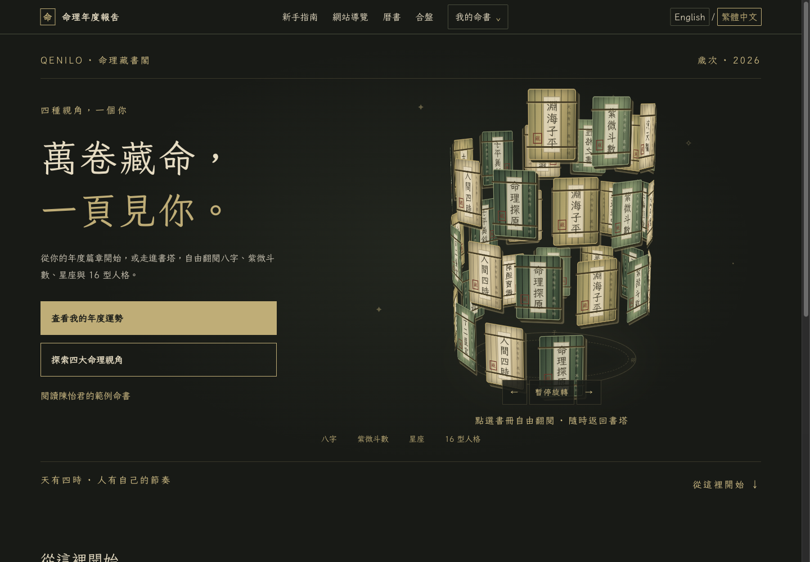
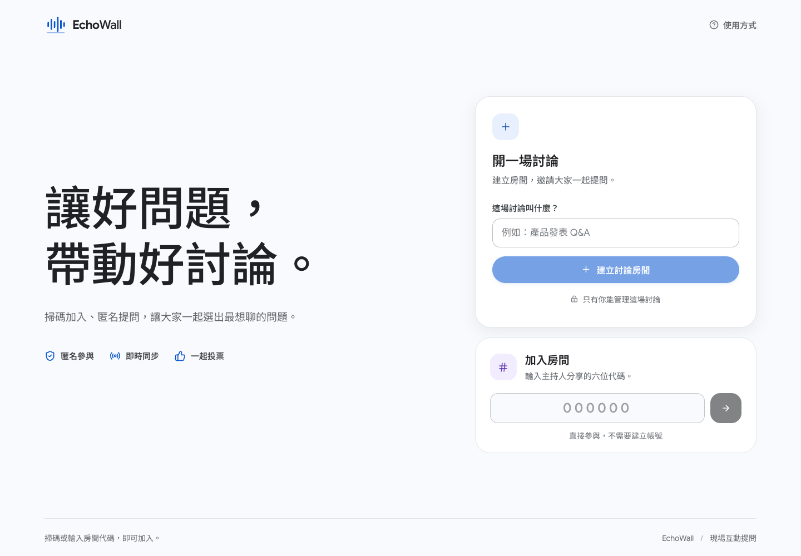
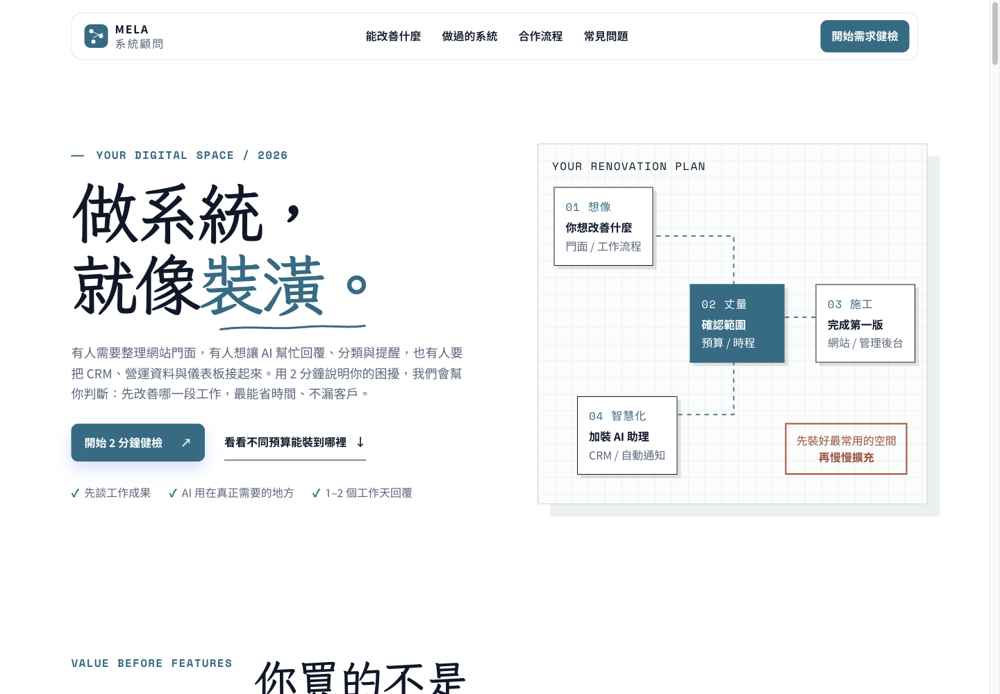

# 蔡政霖｜產品與專案作品集

以實際產品畫面說明解決的問題、使用方式與可延伸場景。此作品集公開圖文介紹與操作手冊；私有產品原始碼、帳戶資料及客戶資料未納入。

| 專案 | 使用情境 | 介紹與手冊 | 體驗入口 |
| --- | --- | --- | --- |
| Qenilo 命理藏書閣 | 個人化年度內容與互動閱讀 | [圖文介紹](qenilo/README.md) · [使用手冊](qenilo/USER-GUIDE.md) | [qenilo.com](https://qenilo.com/) |
| EchoWall 回聲牆 | 演講、教學與工作坊的即時問答 | [圖文介紹](echowall/README.md) · [使用手冊](echowall/USER-GUIDE.md) | 目前無固定公開體驗網址；依手冊安排演示 |
| MELA 系統需求健檢 | 系統顧問與企業需求蒐集 | [圖文介紹](system-budget/README.md) · [使用手冊](system-budget/USER-GUIDE.md) | [開啟網站](https://mela0976.github.io/system-budget-consultation/) |

## Qenilo

從公開範例開始了解年度與月度命書，以及個人化內容的閱讀體驗。[查看完整介紹](qenilo/README.md)

## EchoWall

主持、聽眾與投影三端共享即時問答，將現場提問、支持與討論整理在一起。[查看圖文介紹](echowall/README.md)

## MELA 系統需求健檢

以易懂的方案說明與四步表單，協助釐清第一期系統範圍。[查看完整介紹](system-budget/README.md)

## 閱讀說明

「可延伸場景」代表可討論的產品或服務方向，不等同已取得營收、客戶或商業成效。每份手冊列出資料來源、畫面日期與操作驗證範圍；登入、付款、通知與實際使用者資料處理等功能，未執行時會明確註記。

[個人網站](https://mela0976.github.io/ai-trainer-profile/) · [GitHub 個人頁](https://github.com/mela0976) · [返回專案首頁](../README.md)
