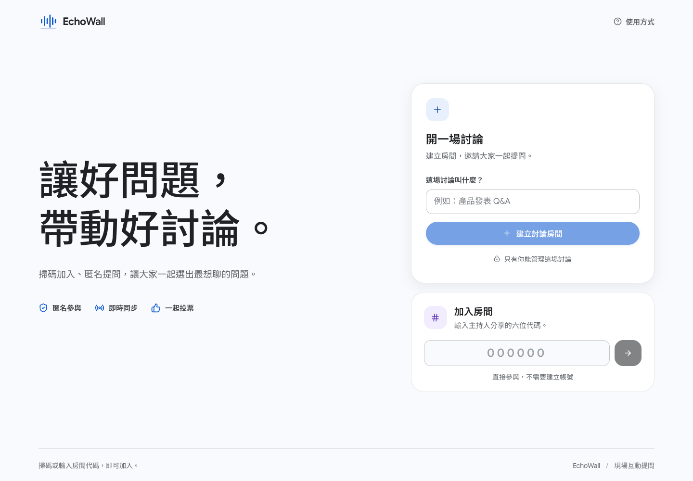

# EchoWall 回聲牆

> 讓好問題，帶動好討論。

EchoWall 是為現場交流設計的即時問答工具。主持人建立一場活動後，聽眾掃描 QR code 或輸入六位房號即可加入，匿名提問、補充回覆並支持感興趣的問題；主持人可以聚焦問題、標記已回答，投影畫面會同步更新。

*首頁畫面｜本機示範流程截圖，2026-11-04。*

## 一場活動怎麼進行

1. 主持人建立活動，取得分享 QR code 與六位房號。
2. 聽眾用手機加入，不需要建立帳號。
3. 聽眾匿名提問、回覆彼此，並為想優先討論的問題投票。
4. 主持人按票數與現場節奏挑選問題，聚焦到投影畫面並在回答後完成該題。
5. 活動結束後，主持人可匯出問答紀錄。

## 三種使用角色

- **主持人**：建立活動、分享加入方式、整理待回答問題、聚焦題目、標記回答完成及結束活動。
- **聽眾**：掃碼或輸入房號加入，以匿名方式提問、回覆及支持問題；暱稱可留白。
- **投影畫面**：全螢幕展示主持人目前聚焦的問題與加入方式，讓台上台下看著同一個討論進度。

## 適用方向

可用於演講與座談問答、課程與工作坊交流、產品說明或團隊討論。這些是產品的使用方向，不代表已完成的客戶合作或商業部署案例。

## 操作手冊

建立活動、聽眾加入、提問與支持、主持聚焦、投影、結束及匯出步驟，請看[使用手冊](USER-GUIDE.md)。

## 使用前請留意

- EchoWall 不要求聽眾註冊，但「匿名」不等於身分驗證。參與者可能因提問內容或暱稱被認出；請勿輸入個資、機密或不適合公開的內容。
- 六位房號與加入連結是公開入口。知道房號的人可以查看活動內容；請只分享給預期參與者。
- 主持權限保存在建立活動的原瀏覽器。請用同一個瀏覽器返回主持後台，並避免清除該瀏覽器的網站資料；目前沒有帳號式的主持權限復原方式。
- 同一匿名瀏覽器工作階段對同一題只能投一票。清除瀏覽器資料後可能建立新的匿名工作階段，因此投票不能作為實名一人一票依據。
- 完成回答是結束單一問題；結束活動則會鎖定聽眾後續提問、回覆與投票。結束後不能重新開放，清除紀錄也無法復原，請先匯出再清除。
- **目前沒有固定公開試用網址。** 本頁截圖來自本機合成示範流程；圖中的活動、問題及房號僅供說明，不是可加入的現場活動。正式使用前，主持人須先確認所用服務網址可由聽眾裝置連線。

## 示範畫面

手冊中的手機提問及主持人聚焦畫面取自 2026-11-04 本機合成示範流程。畫面內示範房號與問題不代表真實活動，也不可作為加入連結使用。

本次文件整理沿用既有示範截圖與操作說明，未重新執行完整三端流程。

返回[作品集專案索引](../README.md)。
