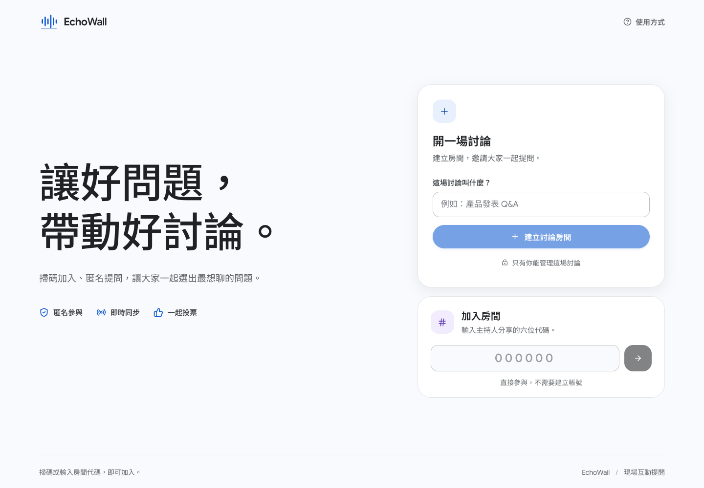
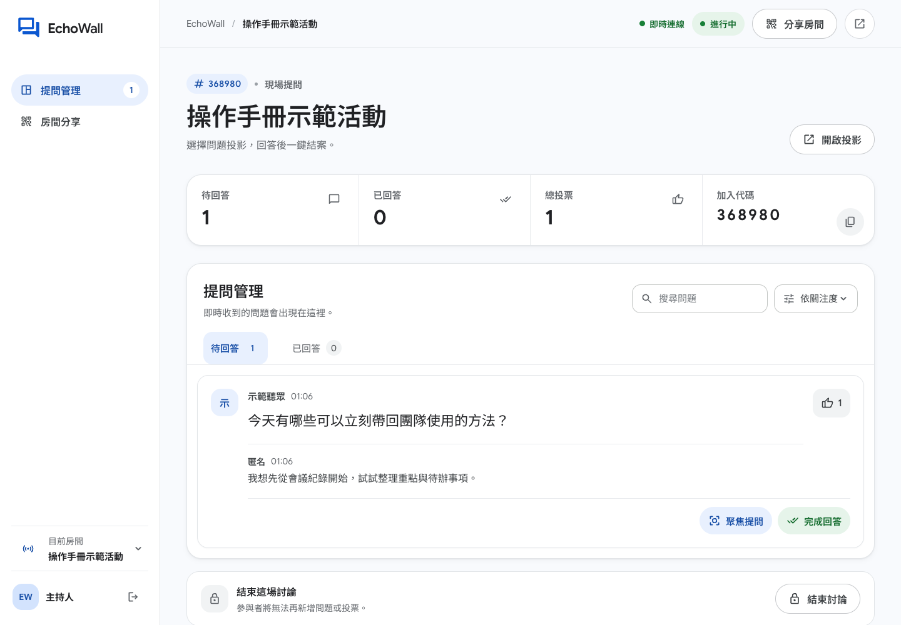
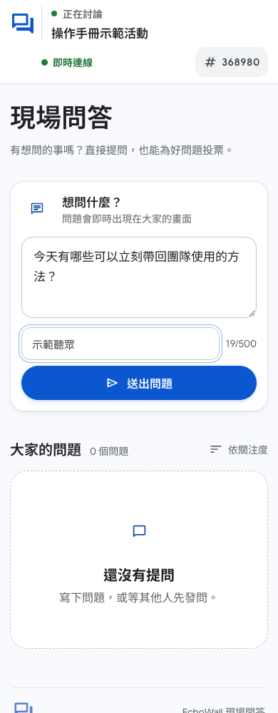

# EchoWall 使用手冊

更新日期：2026-11-04  
截圖來源：EchoWall 本機合成示範流程。圖中的房號、活動名稱及問題是示範資料，不對應真實活動，也不是可加入的公開房間。

本次整理沿用既有示範截圖與操作說明，未重新執行完整三端流程。

EchoWall 分成主持後台、聽眾頁面和投影畫面。主持人建立活動並分享加入方式；聽眾加入後提問、回覆及支持問題；主持人挑選問題並在投影畫面帶領討論。

> **目前沒有固定公開試用網址。** 正式活動前，請先確認所使用的 EchoWall 網址能從聽眾手機及投影電腦開啟。`localhost` 只代表目前這台裝置，不能直接分享給其他人。

## 使用前先確認

- 主持人準備一台可開啟 EchoWall 的電腦；若要投影，另開投影畫面並接上大螢幕。
- 聽眾用手機加入。主持人分享的 QR code 或房號必須對應一個聽眾可以連線的服務網址。
- 房號是公開入口，知道房號的人可能查看活動內容。請勿在活動中放入個資、機密或需要保密的討論。
- 主持人權限留在建立活動的原瀏覽器。請用同一個瀏覽器回到後台，並保留其網站資料。

## 主持人：建立與帶領活動

### 1. 建立活動

在首頁輸入活動名稱，按「建立討論房間」。建立活動不需要帳號；建立時使用的瀏覽器會取得該活動的主持權限。

*首頁示意圖｜本機畫面，2026-11-04。*

請保留原瀏覽器的網站資料。EchoWall 目前沒有帳號登入或主持權限復原流程；若清除該瀏覽器資料，可能無法再管理原活動。

### 2. 分享加入方式

在主持後台按「分享房間」，可讓聽眾掃描 QR code、開啟加入連結，或在首頁輸入六位房號。投影頁也會顯示加入方式，方便遲到的聽眾加入。

房號及加入連結不是私密邀請憑證。請只分享給預期參與者；持有房號的人可以查看該活動內容。圖解畫面中的房號與連結均為示範資料。

### 3. 聚焦問題並使用投影

問題出現後，主持人可在問題卡片按「聚焦提問」。按「開啟投影」會進入獨立展示頁，再將畫面切換至全螢幕。投影會即時顯示主持人選中的問題；主持人管理操作仍在後台進行。

*主持人畫面｜問題與房號為合成示範資料，2026-11-04。*

### 4. 完成回答

討論完一題後按「完成回答」。該題會移到「已回答」，並從目前投影焦點移除；如果主持人正在聚焦的題目已完成，下一個熱門待答問題會接續顯示。若需重新討論，可從已回答問題還原。

「完成回答」只結束單一題目，不會結束整場活動。

### 5. 結束活動

所有問題處理完後，在主持後台底部按「結束討論」，再確認一次。活動結束後，聽眾不能再提問、回覆或投票；仍可瀏覽已留下的紀錄，但此版本不能重新開放活動。

## 聽眾：加入與參與

### 6. 加入活動

掃描主持人分享的 QR code，或在首頁輸入六位房號。加入不需要註冊。若房號無效或活動已不存在，請向主持人確認加入方式。

不要用圖中的示範房號嘗試加入。正式加入時，請使用主持人當場分享的 QR code 或房號。

### 7. 提問

在「想問什麼？」欄位輸入問題並按「送出問題」。暱稱可以留白；留白時會以匿名顯示。每題最多 500 字。

*手機提問畫面｜房號、活動名稱及問題為合成示範資料，2026-11-04。*

匿名不代表保密：房間內的其他參與者及持有房號的人都可能看到提問。請勿填入姓名、電話、電子郵件、客戶資料或其他敏感資訊。

### 8. 支持問題與補充回覆

對想優先討論的問題點選支持／投票按鈕；票數更新後，問題會依支持度排序。按「回覆」可補充想法，暱稱同樣可以留白。

同一匿名瀏覽器工作階段對同一題只能支持一次。這不是登入、實名或可靠的一人一票機制；清除瀏覽器資料後可能建立新的匿名工作階段。

## 匯出問答紀錄

### 9. 匯出與清除

活動結束後，在主持後台按「匯出紀錄」下載 JSON 問答檔。確認檔案已下載並妥善保存後，若不再需要線上紀錄，再按「清除問題」。清除無法復原；不要在尚未匯出時清除。

匯出的檔案可能包含參與者提交的文字，請依活動需要妥善保管與分享。

## 常見問題

### 聽眾掃碼後無法加入，怎麼辦？

確認 QR code 或房號來自目前這場活動，並檢查聽眾手機能否開啟主持人分享的服務網址。`localhost` 只會連到手機本身，不能作為分享給其他裝置的網址。若房號仍無法使用，請主持人重新確認房間狀態與分享內容。

### 聽眾需要註冊或留下姓名嗎？

不需要。暱稱是選填；空白時以匿名顯示。參與者仍應避免提交可識別個人或機密的內容。

### 支持票可以代表出席人數或正式表決嗎？

不可以。支持票用來協助整理討論優先順序；它不是身分驗證或正式投票機制。

### 主持人換了瀏覽器或清除網站資料，還能管理原活動嗎？

目前主持權限保存在建立活動的原瀏覽器，沒有帳號式復原方式。請保留該瀏覽器的網站資料；若已遺失權限，這個版本沒有自助復原流程。

### 活動結束後可以繼續提問或重新開放嗎？

不能。結束活動會鎖定後續提問、回覆及投票，也不能重新開放。若需要另一場討論，請建立新活動。

### 目前可以直接試用嗎？

目前沒有固定公開試用網址。本文件與截圖用於介紹操作流程；正式活動前，需由主辦方確認所使用的服務網址可供參與者連線，並先完成預演。

---

返回[EchoWall 介紹](README.md)。
