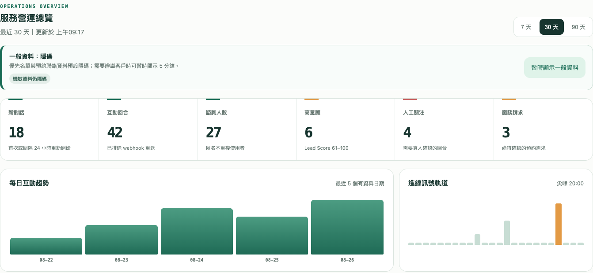

# LINE AI 助理

將 LINE 諮詢、知識問答與客戶追蹤串成同一段服務流程。適合需要整理重複問題、安排真人接手及追蹤後續需求的服務團隊。

[使用手冊](USER-GUIDE.md) · [返回作品集](../README.md)

## 服務流程

客戶從 LINE 提問 → 系統依核可 FAQ、公開搜尋或知識庫處理 → 有需要時通知真人 → 團隊從看板追蹤需求與待辦。

- 接收文字、圖片與語音訊息。
- FAQ 與知識庫問答，依設定使用不同來源。
- 真人通知與面談需求整理，AI 對話可持續使用。
- CRM 看板呈現互動趨勢、需求分類、待辦及客戶追蹤。
- 一般資料預設隱碼；敏感資訊依權限與政策處理。

## 展示範圍

此頁為 LINE_CRM 的公開作品介紹，不提供私人試用入口、產品原始碼、客戶資料或憑證。畫面取自既有操作手冊的測試數據，不代表實際客戶數、營收或服務成效。

來源：本機專案 README、操作手冊與測試畫面，於 2026-11-04 核對。本次未執行 LINE 真實訊息、付款或通知測試；正式啟用仍需完成該部署的設定與驗收。
