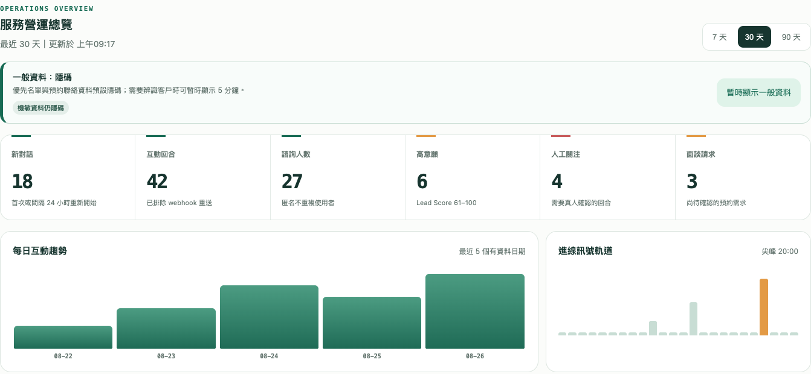

# LINE AI 助理｜使用手冊

[產品介紹](README.md) · [作品集](../README.md)

本手冊說明服務經營者與使用者的操作流程。此作品集未提供公開登入或加入連結；使用前需由管理者提供已配置完成的服務入口與 LINE 官方帳號。

## 1. 建立服務工作區

依管理者提供的入口註冊或登入，確認所在工作區與服務設定。若未取得帳號或權限，請向管理者申請，不要使用他人的帳號。

## 2. 完成 LINE 與 AI 設定

由管理者連接 LINE 官方帳號與 AI 服務，設定核可的知識庫與通知方式。請在管理介面處理憑證，不將金鑰貼到 LINE 對話或公開文件。方案、用量與付款狀態以該部署實際啟用的功能為準。

## 3. 從 LINE 開始提問

加入管理者提供的 LINE 官方帳號，傳送文字問題；圖片與語音功能需依該部署設定使用。先使用不含個資的測試問題，確認收到符合知識來源的回覆，再安排團隊試用。

FAQ 可直接提供核可答案；其他問題依設定使用公開搜尋或知識庫。知識來源不足時，應核對警語並安排真人確認，不將 AI 回答視為個別案件的最終判定。

## 4. 需要真人時

在對話輸入「轉真人」，通知服務人員接手。通知不代表真人已讀或已處理，請由團隊在待辦中追蹤；AI 對話仍可繼續。面談需求依部署提供的預約流程送出，時間需等待真人確認。

## 5. 查看服務營運總覽

登入有權限的管理看板，選擇觀察期間，檢視互動回合、諮詢人數、人工關注與面談需求。依需求與待辦安排下一步；數據欄位是否可用取決於部署版本與資料累積。

一般資料預設隱碼。只有具權限且有業務需要時，才使用介面提供的暫時顯示功能；不要公開截圖中的客戶資料。

## 6. 重新開始與問題排查

- 輸入「清除紀錄」或使用「重新開始」，可清除短期會話；這不代表刪除所有後台保存紀錄。
- 未收到回覆：先確認官方帳號與訊息送達情況，再由管理者檢查服務狀態、用量與 LINE 設定，避免連續重送敏感資料。
- 知識庫回答不足：由管理者核對核可資料及同步狀態，不在對話中貼入未核可的私人文件。
- 真人尚未回覆：由服務團隊追蹤待辦與通知狀態，緊急問題改用既有正式聯絡管道。

## 驗證範圍

依 2026-11-04 讀取的 LINE_CRM README 與既有操作手冊整理。圖片為既有手冊測試畫面；本次只驗證作品集文件、圖片與連結，未重新測試登入、LINE 傳送、通知、付款或正式資料處理。
