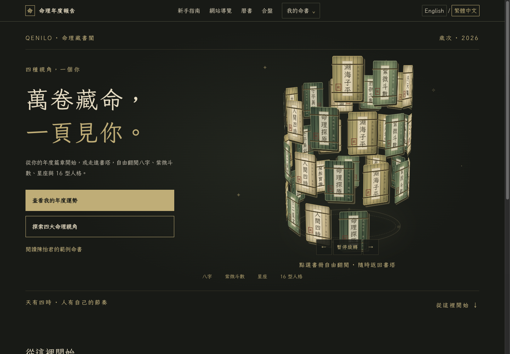
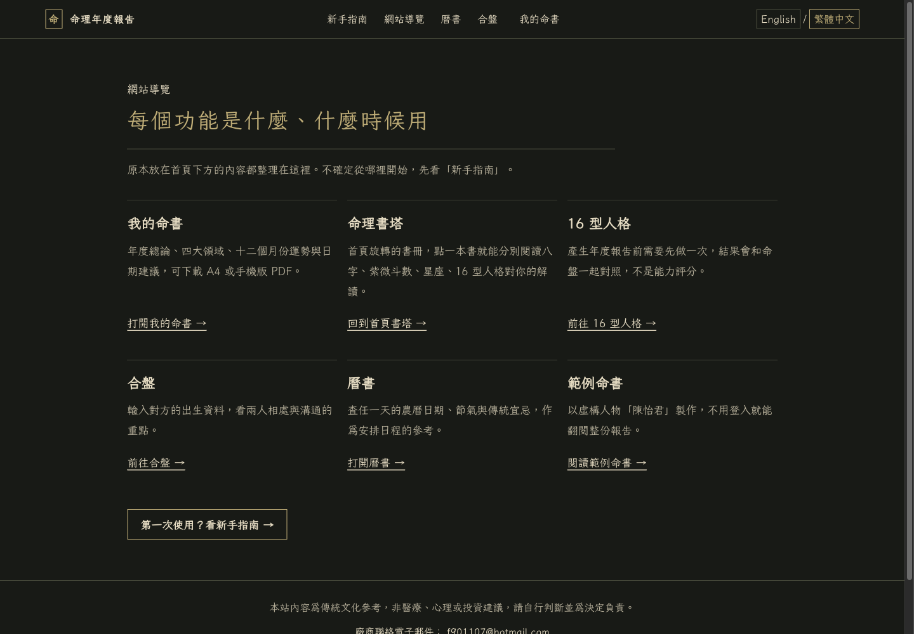
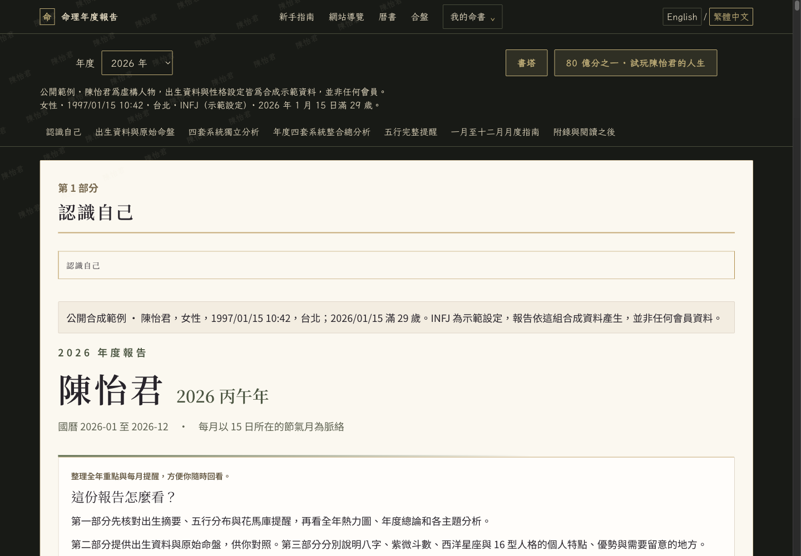

# Qenilo｜命理藏書閣

[體驗 Qenilo](https://qenilo.com/) · [圖文使用手冊](USER-GUIDE.md) · [公開範例](https://qenilo.com/demo/chen-yijun)

Qenilo 將八字、紫微、星座與 16 型人格整理成可瀏覽的個人命書，讓使用者從傳統文化與自我探索的角度回看年度主題。網站提供公開範例，也提供 LINE 登入後建立與管理個人命書的流程。

本服務適合作為文化閱讀與生活參考，不是醫療、心理或投資建議，也不保證預測準確。

## 產品特色

- **四種觀點**：整合八字、紫微、星座與 16 型人格，提供不同的閱讀角度。
- **年度閱讀**：報告以全年熱力圖連結月份內容，方便瀏覽年度節奏與十二個月章節。
- **命書收藏與閱讀**：登入後可使用「我的命書」管理報告。官方指南列有 A4 列印版與手機閱讀版 PDF。
- **網站功能入口**：包含我的命書、命理書塔、16 型人格、合盤、曆書與公開範例；各入口以網站導覽頁為準。

## 公開頁面

- [Qenilo 首頁](https://qenilo.com/)
- [使用指南](https://qenilo.com/guide)
- [網站功能導覽](https://qenilo.com/site-guide)
- [陳怡君公開範例](https://qenilo.com/demo/chen-yijun)（免登入，可讀 2026 與 2027 年範例）

## 畫面預覽

以下畫面取自 2026-11-04 的公開網站頁面。陳怡君是全合成的示範人物，不是會員資料。

### 首頁與命理書塔

*首頁呈現命理書塔與產品入口。*

### 網站功能導覽

*導覽頁整理網站主要功能與公開範例入口。*

### 公開命書範例

*公開合成範例的報告首頁與章節導覽；人物及資料皆為合成示範。*

## 可展示成果

- 可直接瀏覽的公開網站、功能導覽與免登入年度報告範例。
- 年度報告的熱力圖、月份跳轉與十二個月內容呈現方式。
- 官方指南所列的個人命書收藏，以及 A4 與手機閱讀 PDF 輸出選項（本次未登入會員帳戶操作下載）。

## 使用方式

先看[陳怡君公開範例](https://qenilo.com/demo/chen-yijun)，或前往[使用指南](https://qenilo.com/guide)了解登入與建立流程。完整操作說明見[使用手冊](USER-GUIDE.md)。

## 可延伸方向

以下是產品構想，不代表目前已有營收、客戶或使用者規模：年度內容付費、文化教育或工作坊合作、關係合盤的閱讀體驗，以及可供合作品牌採用的主題式內容服務。

## 聯絡與來源

- 官方網站：[qenilo.com](https://qenilo.com/)
- 公開服務聯絡：[f901107@hotmail.com](mailto:f901107@hotmail.com)
- 畫面來源：Qenilo 公開頁面，截圖日期 2026-11-04。
- 原始碼維持私有；本介紹不連結私有程式碼儲存庫。

[返回作品集](../README.md)
