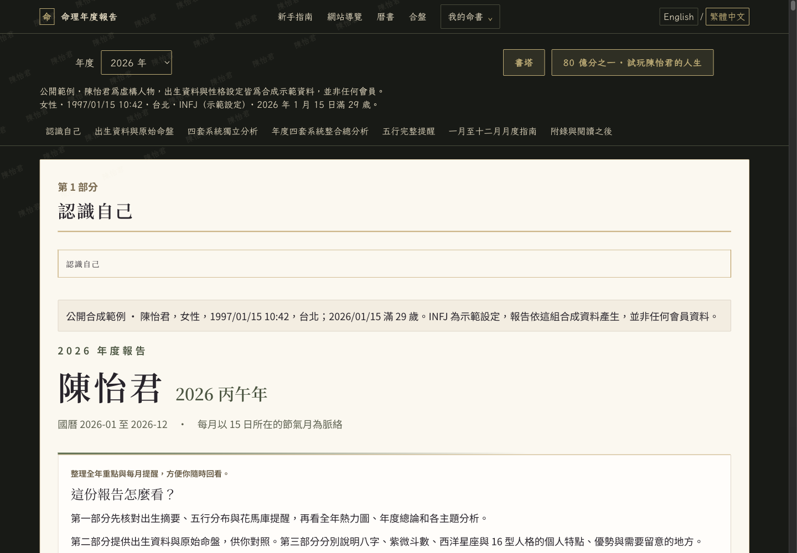
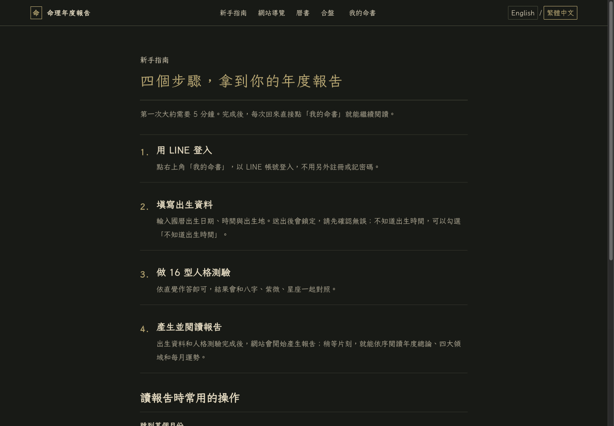
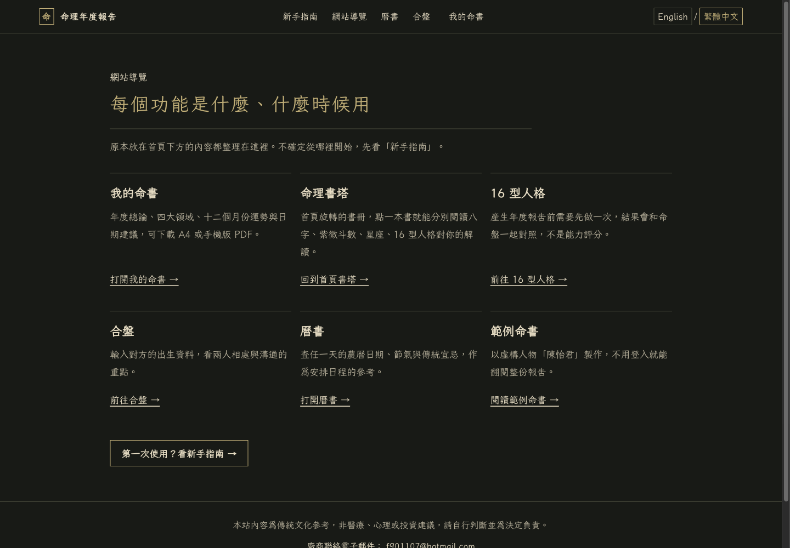

# Qenilo 使用手冊

本手冊依 Qenilo 於 2026-11-04 的公開頁面與畫面整理。開始前可先看[官方使用指南](https://qenilo.com/guide)；網站各入口見[功能導覽](https://qenilo.com/site-guide)。

## 先看公開範例

前往[陳怡君命書範例](https://qenilo.com/demo/chen-yijun)，不需登入即可閱讀 2026 與 2027 年內容。範例以全合成的陳怡君為示範人物，不含會員資料。

報告上方的全年熱力圖可點選月份並跳到對應內容；範例也提供十二個月份的閱讀章節。公開範例可先用來了解報告呈現方式，再決定是否建立自己的命書。

## 建立個人命書

官方使用指南列出以下四步：

1. **使用 LINE 登入**：從[首頁](https://qenilo.com/)進入登入流程。
2. **填寫出生資料**：輸入國曆出生日期、出生時間與出生地。送出後欄位會鎖定，請在送出前再次核對；若不清楚出生時間，使用頁面提供的「不知道出生時間」選項。
3. **完成 16 型人格測驗**：依頁面題目完成測驗。
4. **產生命書**：完成前述步驟後產生報告，並於「我的命書」查看。

網站文案標示約五分鐘可完成；這是網站提供的時間估計，本次沒有實際計時驗證。

## 閱讀報告與匯出 PDF

- 點選報告上方熱力圖中的月份，可跳至對應月份內容。
- 在「我的命書」查看已建立的個人報告與命書列表。
- 官方指南說明，「我的命書」選單提供 **A4 列印版 PDF** 與 **手機閱讀版 PDF**。

PDF 選項依官方指南記載；本次未登入會員帳戶，也未實際下載或列印會員 PDF。

## 常見狀況

- **不確定出生時間**：送出前勾選頁面上的「不知道出生時間」選項。
- **出生資料尚未確認**：先不要送出。官方指南指出送出後欄位會鎖定；請先確認日期、時間與出生地。
- **已送出錯誤資料或需要更正**：本次未驗證會員資料的修改方式，請依網站當下的操作說明處理，或聯絡[公開服務信箱](mailto:f901107@hotmail.com)。
- **找不到個人命書**：確認已使用建立命書時的 LINE 帳號登入，再從「我的命書」查看。
- **PDF 無法開啟或下載**：可先嘗試重新開啟選單或使用瀏覽器下載功能；若仍有問題，請附上操作頁面並聯絡公開服務信箱。此排查方式未經會員帳戶實測。

## 登入與資料說明

公開範例可免登入閱讀；建立與查看個人命書需經 LINE 登入。建立流程會要求出生日期、出生時間、出生地，並包含 16 型人格測驗。請只在確認資料無誤後送出。

本次未查證資料保存期限、使用目的、刪除方式或第三方資料處理細節；涉及個人資料的實際規範，請以網站當下公布的隱私說明及服務條款為準。若頁面未提供所需資訊，可先向公開服務信箱詢問。

## 已確認與未驗證範圍

**已確認**：首頁、使用指南、功能導覽及公開範例網址於 2026-11-04 回應 HTTP 200；本手冊所列登入步驟、PDF 選項及公開範例內容依公開頁面資訊整理。三張配圖是同日公開頁面實拍。

**未驗證**：LINE 會員登入、出生資料送出、會員報告實際生成、資料更正流程、PDF 下載與列印、資料保存及隱私處理，以及約五分鐘的完成時間。不要把本手冊解讀為上述會員功能已完成端到端測試。

## 相關連結

- [Qenilo 首頁](https://qenilo.com/)
- [官方使用指南](https://qenilo.com/guide)
- [網站功能導覽](https://qenilo.com/site-guide)
- [陳怡君公開範例](https://qenilo.com/demo/chen-yijun)
- [公開服務聯絡信箱](mailto:f901107@hotmail.com)

Qenilo 內容以傳統文化、自我探索與生活參考為定位，不構成醫療、心理或投資建議，亦不保證預測準確。

[專案介紹](README.md) · [返回作品集](../README.md)
