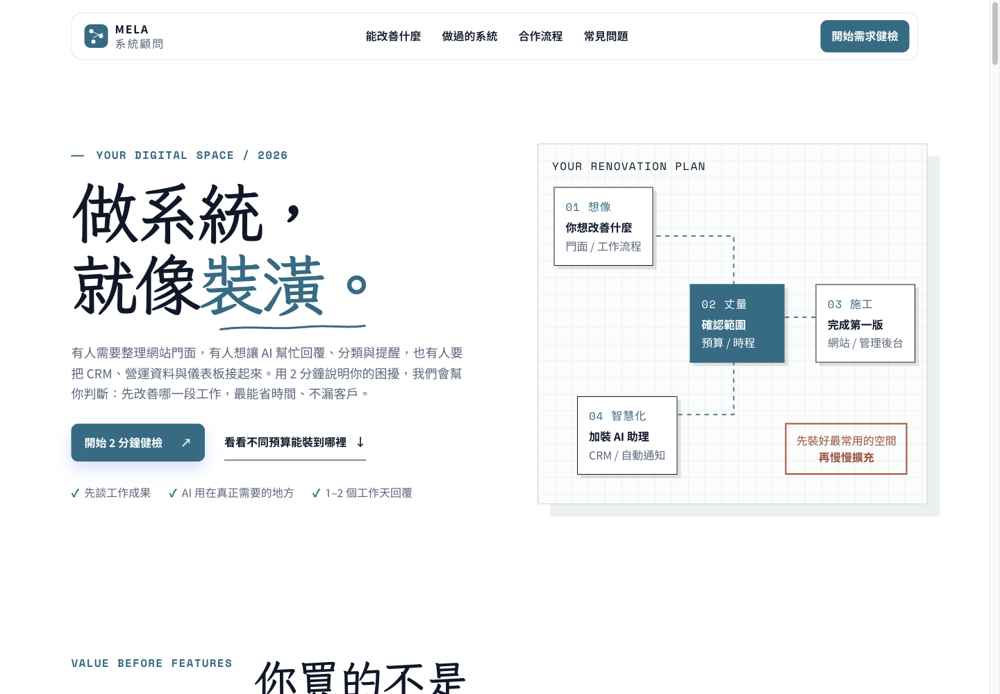
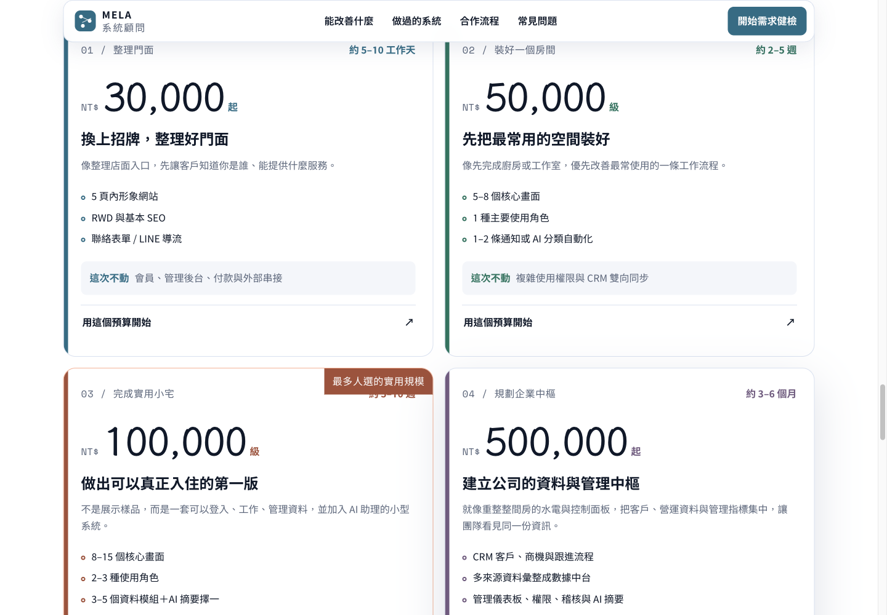

# MELA 系統需求健檢

把「我想做一套系統」轉成能討論的需求、範圍與下一步。以裝潢比喻解釋網站、AI 助理、CRM 與資料整合，讓非技術背景的企業主也能開始溝通。

[開啟網站](https://mela0976.github.io/system-budget-consultation/) · [圖文使用手冊](USER-GUIDE.md) · [原始專案](https://github.com/mela0976/system-budget-consultation)

## 解決什麼問題

企業的第一個問題通常不是選技術，而是釐清想改善哪段工作、誰會使用，以及第一期該包含什麼。此網站提供價值說明、方案比較、常見問題與四步需求健檢，將模糊詢問整理成可追問的資訊。

| 功能 | 使用者能做什麼 |
| --- | --- |
| 方案比較 | 比較不同預算下的範圍與排除項目，正式價格以網站及個別報價為準 |
| 四步需求健檢 | 依序說明問題、現況、預算／功能與聯絡方式 |
| 通知整合 | 原專案設計以 Apps Script 串接 Gmail 與 LINE 通知；本次未送表單驗收通知 |
| 隱私設定 | 選擇分析 Cookie，閱讀資料用途並可撤回選擇 |

## 可商業化的應用方向

可作為系統顧問、軟體工作室或企業整合服務的需求蒐集入口；後續可依服務內容調整方案、資格篩選與通知。這是可延伸的服務場景，不代表已取得客戶、成交或營收。

## 展示與驗證範圍

公開網站與原始專案已存在；此份介紹於 2026-11-04 讀取。已檢視公開頁、方案區與需求表單第一步，沒有輸入真實個資或送出需求，也沒有測試 Gmail／LINE 通知。頁面內的案例流程圖為原站去識別化示意，不是客戶真實資料；情境照片為原站標明的 AI 生成示意。

維護者：[mela0976](https://github.com/mela0976) · [返回作品集](../README.md)
