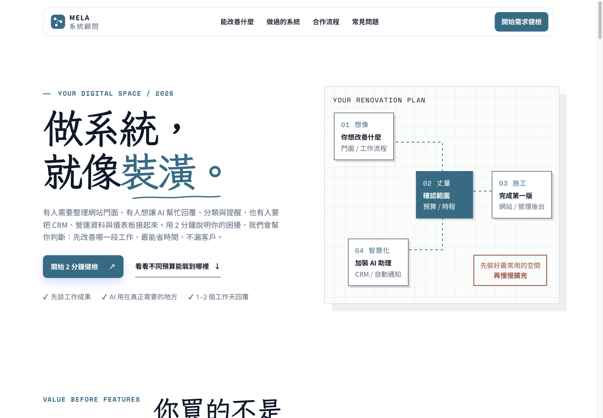
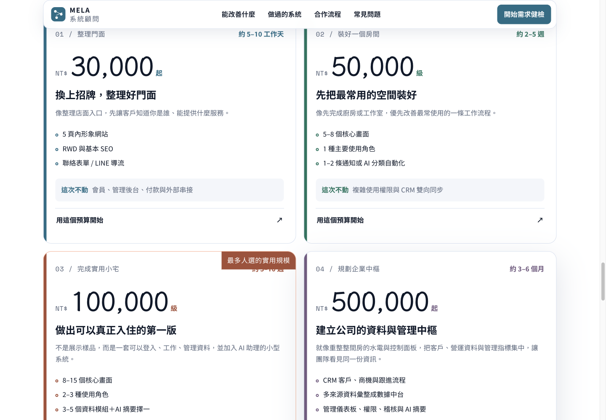
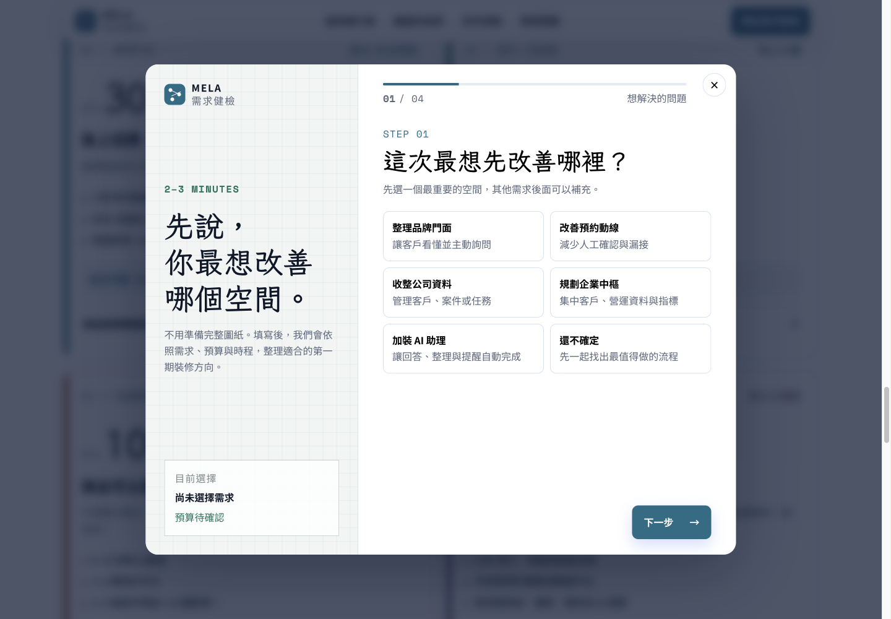

# MELA 系統需求健檢｜使用手冊

適合想規劃網站、AI 助理、管理後台或 CRM／資料整合，尚未有完整規格的人。畫面與文字於 2026-11-04 依公開網站整理；方案、時程與費用以正式網站與個別報價為準。

[開啟網站](https://mela0976.github.io/system-budget-consultation/) · [專案介紹](README.md)

## 1. 先看想改善的工作

從首頁閱讀「能改善什麼」與「做過的系統」，想一個具體例子，例如詢問分散、重複輸入或交接不清。先描述原本怎麼做、哪裡卡住，不必先指定程式語言或雲端平台。

## 2. 比較第一期範圍

點「看看不同預算能裝到哪裡」，比較各方案包含與排除的項目。網站將範圍分為門面整理、單一工作空間、可使用的小型系統與企業資料中樞。不要只看價格，還要核對角色、資料、串接與通知需求。

主機、平台帳號與第三方用量費可能另計；公開方案是規劃基準，並非自動成立的報價或合約。

## 3. 開啟四步需求健檢

點「開始需求健檢」或方案中的開始按鈕。可以先選適合的方案，也可以從未確定預算開始。

| 步驟 | 需要整理的內容 |
| --- | --- |
| 想解決的問題 | 選一個最重要的方向：品牌門面、預約、資料管理、企業中樞、AI 助理，或還不確定 |
| 目前狀況 | 目前是想法、紙本／試算表、已有系統或 CRM，以及希望開始的時間 |
| 預算與功能 | 選預算或需要建議，勾選登入、客戶管理、通知、預約、付款、報表、CRM／API 或 AI 等需求 |
| 聯絡方式 | 姓名、選填的公司／品牌，並至少留 Email、電話或 LINE ID 其中一項；確認資料使用同意 |

可用「上一步」回看。補充說明應聚焦問題與預期成果，不要填密碼、API 金鑰、客戶名單或機密檔案內容。

## 4. 送出與後續聯絡

確認內容與資料用途後，再自行點「送出需求健檢」。以畫面實際顯示的成功訊息為準；出現錯誤時，先檢查必填欄位與網路。原站說明會透過 Gmail 與 LINE 通知顧問，並於 1–2 個工作天回覆；這是網站服務說明，本次沒有送出表單或驗證通知送達。

如果等待逾時而結果不明，先確認是否收到回覆，再決定是否重送，避免重複詢問。

## 5. 調整隱私選擇

首次造訪可選「只使用必要功能」或允許分析 Cookie，之後可從頁尾「隱私設定」調整。依原站說明，進階同意模式即使未同意也可能傳送不使用 Cookie 的評估訊號。

[隱私與資料使用說明](https://mela0976.github.io/system-budget-consultation/privacy.html)

## 本手冊的驗證界線

- 已檢視：首頁、方案比較、公開表單步驟與欄位。
- 未執行：填入個資、送出需求、寄送 Email／LINE、商業交易。
- 截圖是公開頁實拍；沒有客戶資料，也不表示任何客戶推薦。

[原始專案及部署說明](https://github.com/mela0976/system-budget-consultation) · [返回作品集](../README.md)
